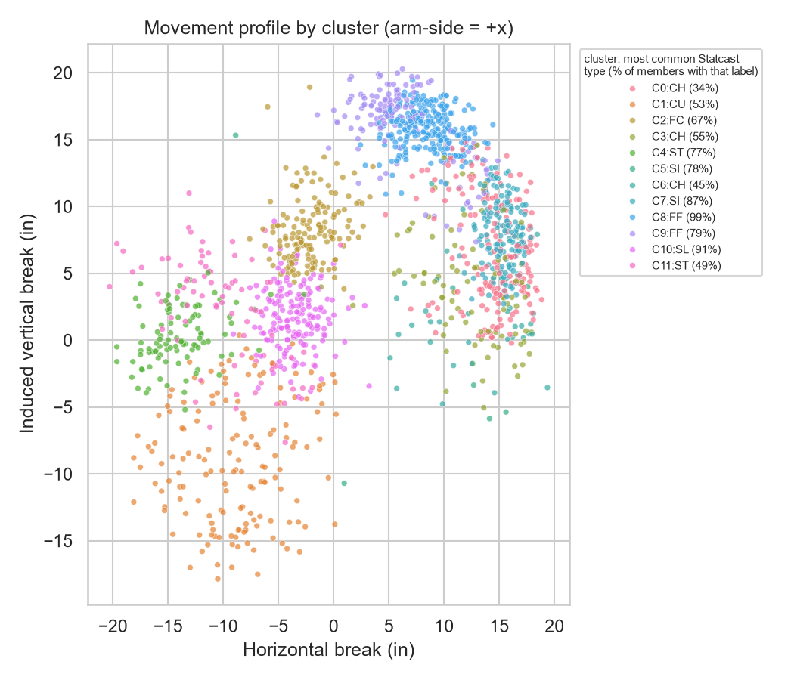

# Pitch Shape Analysis & Pitching Decision Report

Python pipeline on three seasons of MLB Statcast pitches (2024-2026, ~700K pitches each) that
(1) clusters pitches by physical shape and (2) turns the data into front-office-style flags and
measures (shape vs. results, command, contact luck, platoon splits, costly pitches), then tests whether
each one still holds in the following season.

**Headline finding:** tested on seasons the model never saw, two flags clearly held up:
platoon splits (only about 20% of a pitcher's L/R run-value gap carries over) and heavily used
pitches that cost runs (they kept costing runs). Two shape-based flags, "underperforms shape" and
"outperforms shape", showed a modest effect of 1 to 3 whiff points in the expected direction every
time, significant in one of two tests each. As a projection tool the shape model adds only about
1% to a simple regressed whiff rate. The write-up below reports what worked, what didn't and what
was unstable. Adding plate location and batted-ball quality produced a command score that is a
repeatable skill (year-to-year correlation 0.62) and tracks the shape gap closely, but it did not improve
forecasts, and a contact-luck measure from expected wOBA proved weak.

**Read the output:** [outputs/report/REPORT_2026.md](outputs/report/REPORT_2026.md)
(also `REPORT_2024.md`, `REPORT_2025.md`)



Pitch-shape clusters in movement space (12 clusters, chosen by BIC; silhouette favors fewer,
so treat the cluster count as a modeling choice).

## What it does

| Stage | Module | Output |
|---|---|---|
| Load + cache Statcast via pybaseball | `pitchcluster/data.py` | `data/statcast_<year>.parquet` |
| Pitch-shape features (velo, spin, movement, extension, release, spin axis; LHP mirrored) | `features.py` | pitcher x pitch profiles |
| Gaussian-mixture clustering of pitch shapes (k chosen by BIC/silhouette) | `cluster.py`, `run.py` | `outputs/*.csv`, `figures/` |
| Decision report: shape-vs-results, command, contact luck, platoon splits, costly pitches | `report.py` | `outputs/report/REPORT_<year>.md` |
| Command score (location-aware vs. shape-only expected whiff), zone/chase rates, contact luck (wOBA vs. expected) | `command.py` | `command_scores_<year>.csv`, `contact_luck_<year>.csv` |
| Does command explain the shape flags? | `commandsplit.py` | `command_vs_shape_flags.csv` |
| Year-ahead holdout tests of the shape flags | `holdout.py` | `outputs/report/holdout_*.csv` |
| Year-ahead tests of the platoon and costly-pitch flags | `flagtests.py` | `outputs/report/flagtests_*.csv` |

## The decision report (`python -m pitchcluster.report <year>`)

The report opens with key takeaways, a trust table for each section and a table of pitchers flagged in more than
one section. Every evidence statement is read from the saved test outputs (`holdout_summary_*`, `flagtests_*`,
`command_vs_shape_flags`), so it cannot drift from the tests. Reports for years before the last tested season carry a
"retrospective" note, because the evidence they cite uses later seasons. Tables show readable headers, "First Last"
names and a team column.

- **Underperforms / outperforms shape.** A pitch-level gradient-boosted model predicts the chance of
  a miss on every swing from velocity, spin, movement, extension, release point, how the pitch
  differs from the pitcher's own fastball (speed and break separation) and batter side. It is fit
  out-of-fold by pitcher, then averaged per pitcher and pitch type to give an expected whiff rate.
  The gap between actual and expected whiff rate, combined with run value, flags pitches whose
  results lag or exceed their raw stuff.
- **Command.** Per pitcher and pitch type, the average extra (or lost) chance of a miss per swing that his
  locations create compared with a shape-only model, using plate location, count and strike-zone height.
  Zone rate and chase rate induced are shown beside it.
- **Contact luck.** Actual wOBA on balls in play vs. wOBA expected from exit velocity and launch angle.
- **Platoon risks.** Largest run-value gaps between LHB and RHB (400+ pitches each side).
- **Costly heavy-use pitches.** Pitches thrown 15%+ of the time with negative shrunk run
  value, ranked by runs lost vs. the league average for that pitch type.

Run value per 100 pitches is shrunk toward the pitch-type league mean
(`SHRINK_K = 400` pseudo-pitches) to damp small-sample noise.

## Do the flags hold up? Year-ahead tests

Flags are built from year N only and judged on year N+1. Intervals are 95% bootstrap CIs.

### Shape flags (`holdout.py`)
Projection coefficients are fit on the training year's first-half -> second-half relationship,
frozen, then applied to the full training year. About 890 to 920 pitcher-pitch combos per test
with enough data in both seasons.

| Model (swing-weighted RMSE of next-year whiff rate) | 2024 -> 2025 | 2025 -> 2026 |
|---|---|---|
| Naive (last year's whiff rate) | 0.0554 | 0.0547 |
| Regressed whiff rate (baseline) | 0.0509 | 0.0497 |
| Baseline + shape model's expected whiff | 0.0506 | 0.0492 |
| RMSE gain from adding the shape model (95% CI) | 0.0003 (-0.0004 to 0.0009) | 0.0005 (0.0002 to 0.0009) |

| Flag vs. matched controls: next-year whiff-rate change | 2024 -> 2025 | 2025 -> 2026 |
|---|---|---|
| "Underperforms shape" | +1.2 pts (CI -0.2 to +2.7), n=66 | +2.9 pts (CI +1.7 to +4.1), n=82 |
| "Outperforms shape" | -2.1 pts (CI -3.4 to -0.7), n=96 | -0.7 pts (CI -2.0 to +0.6), n=88 |

**How the shape model got here.** The first version predicted whiff from aggregated pitcher-pitch
profiles using raw shape only. It added nothing measurable (RMSE gain 0.0001 and 0.0002, both
intervals spanning zero) and its flags were significant in one test each. Moving to a pitch-level
model with fastball-separation and batter-side features raised the correlation between expected and
actual whiff rate from about 0.71 to 0.75, made all four flag effects point the expected way, and
made the "underperforms" effect larger. The improvement is real but small, and I kept it for flagging
pitches to examine, not for forecasting.

### Platoon and costly-pitch flags (`flagtests.py`)

| Flag | 2024 -> 2025 | 2025 -> 2026 |
|---|---|---|
| Platoon: slope of next-year RV gap on this-year gap (0 = noise, 1 = persistent) | 0.20 (CI 0.06 to 0.35) | 0.22 (CI 0.05 to 0.36) |
| Platoon: top-quartile gaps whose weak side stays the weak side (50% = coin flip) | 63.5% (CI 52 to 75), n=52 | 64.8% (CI 52 to 78), n=54 |
| Costly heavy-use pitches: next-year RV/100 vs. pitch-type average, flagged minus unflagged | -0.78 (CI -1.23 to -0.28), n=33 | -0.35 (CI -0.68 to -0.01), n=41 |

### Command and contact luck (`flagtests.py`, `commandsplit.py`)

| Test | 2024 -> 2025 | 2025 -> 2026 |
|---|---|---|
| Command score: year-to-year correlation | 0.62 (CI 0.56 to 0.68), n=781 | 0.62 (CI 0.55 to 0.68), n=825 |
| Command score: RMSE gain predicting next-year whiff, beyond last year's whiff and shape-expected whiff | 0.0000 (CI -0.0003 to 0.0004) | 0.0002 (CI -0.0003 to 0.0007) |
| Correlation of the shape gap (actual minus expected whiff) with command score | 0.67 | 0.68 |
| "Outperforms shape" pitches, high vs. low command: next-year whiff change vs. matched controls | -3.3 pts (CI -5.2 to -1.4) vs. -2.8 pts (CI -4.7 to -0.8), n=36 each | -2.5 pts (CI -4.5 to -0.6) vs. -2.7 pts (CI -4.6 to -0.7), n=34 each |
| Contact luck: RMSE gain predicting next-year wOBA on contact, adding expected wOBA | -0.0002 (CI -0.0006 to 0.0002), n=218 | 0.0004 (CI -0.0007 to 0.0014), n=222 |
| Contact luck, "unlucky" pitchers (actual above expected): next-year wOBA-on-contact change vs. controls | -.021 (CI -.035 to -.006), n=35 | -.003 (CI -.023 to +.014), n=34 |
| Contact luck, "lucky" pitchers: same | +.008 (CI -.009 to +.022), n=29 | +.017 (CI -.001 to +.033), n=32 |

The command-split rows use somewhat different sample cutoffs than the holdout table above (100+ swings), which
is why the "outperforms" effect there is larger. That sensitivity is one more reason to call the shape flags modest.

### What holds up and what doesn't
- **Holds up (both years):** regressing last year's whiff rate toward the mean cuts error 8 to 9% vs.
  carrying it forward; costly pitches stay costly; platoon gaps are real but only about 20% persists,
  so shrink them hard, and the weak side stays weak roughly 2 times out of 3.
- **Modest, consistent in direction:** the shape flags. Every one of the four flag comparisons moved
  the expected way (underperformers improved, outperformers regressed), with effects of 1 to 3 whiff
  points, but only one of two tests per flag was significant.
- **Command is a real, repeatable skill, but not a forecasting edge.** It tracks the shape gap closely
  (correlation 0.67 to 0.68) and persists year to year (0.62), yet adds nothing to last year's whiff rate for
  predicting next year, and high-command "outperformers" regressed about as much as low-command ones. My initial
  guess that command would make those results durable was wrong.
- **Contact luck is weak:** expected wOBA did not beat actual wOBA at predicting next year; the flagged groups moved the
  expected way in all four comparisons but only one was significant, with 29 to 35 pitchers each.
- **Not a forecasting tool:** adding the shape model to the regressed baseline improves error by about 1%.
- Run-value change rows in `holdout_summary_*.csv` are confounded (flags were selected partly on
  run value, so regression to the mean is baked in). They are not independent evidence.

**Caveats:** whiff rate is the only outcome the shape and command models target. Sequencing and tunneling
are not modeled. Team is each pitcher's last team of the season, so traded pitchers show their final club. Strike-zone boundaries use a standard approximation
(plate half-width plus ball radius). Flagged samples (29 to 96 per test) give wide intervals. Three seasons is a short history.

## Run it

```
python -m venv .venv && .venv\Scripts\activate
pip install -r requirements.txt
python -m pitchcluster.data 2024        # download + cache (needs internet; slow). Repeat for 2025, 2026
python -m pitchcluster.run 2024         # shape clusters, figure, tables
python -m pitchcluster.holdout 2024 2025  # shape-flag test, fit 2024 / score 2025
python -m pitchcluster.holdout 2025 2026
python -m pitchcluster.flagtests 2024 2025 # platoon, costly-pitch, command, contact-luck tests
python -m pitchcluster.flagtests 2025 2026
python -m pitchcluster.report 2024      # decision report; repeat for 2025, 2026
python -m pitchcluster.commandsplit     # command vs. shape flags (needs the report outputs for all three years)
python -m pitchcluster.report 2024      # re-run reports once so they pick up the command-split evidence (2025, 2026 too)
```

Order matters: the report reads the test outputs for its evidence, and `commandsplit` reads the report outputs.
After the data is cached, the full pipeline takes roughly 25 minutes (about 2.5 minutes per report).
## Next steps

- Pitch sequencing and tunneling (how a pitch follows the previous one) are the main unmodeled drivers of results.
- Roster-specific reports (filter by team) and a short season-to-date refresh script.

